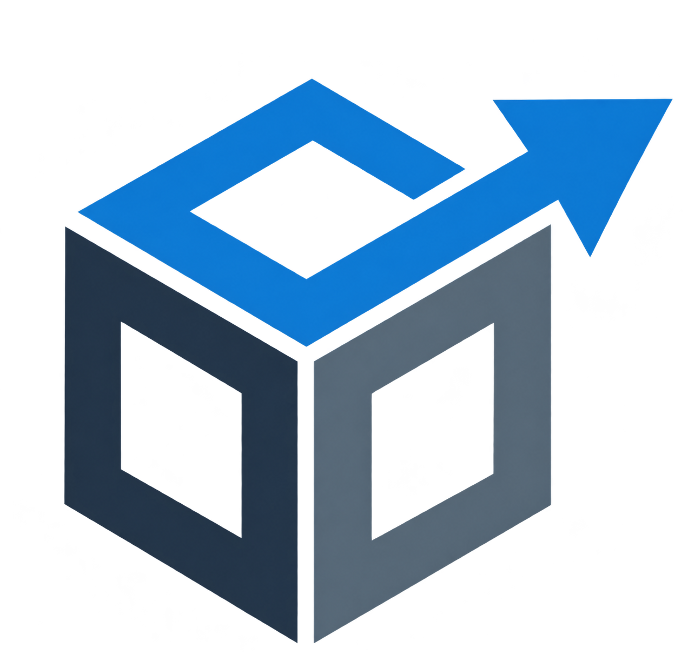

<a id="readme-top"></a>

<div align="center">

  

  # Dagent

  **Agile and lightweight system for customer and sales management**

  [](https://github.com/wh1te-fox/Dagent)
  [](https://www.python.org/)
  [](https://flet.dev/)
  [](LICENSE)

  <p align="center">
    <a href="#-features">Features</a> •
    <a href="#-technologies">Technologies</a> •
    <a href="#-installation">Installation</a> •
    <a href="#-whats-new">What's New</a>
  </p>

  **English** | [Español](README.md)

</div>

---

> **Experimental Space:** This repository is dedicated to the exploration, validation and optimization of technologies. If you have proposals for improvements or new features, contributions are welcome!

---

## Features

-  **Customer Management:** Centralized registration, updating and search of customers.
-  **Sales Control:** Transaction logging and product catalog.
-  **Modern Interface:** Smooth cross-platform experience built on Flet.
-  **Local Storage:** Lightweight and fast SQLite integration.

---

##  Technologies

| Technology | Description |
| :--- | :--- |
|  | Base language (v3.12+) |
|  | GUI framework (UI) |
|  | Relational database engine |

---

## Installation

Follow these steps to clone and run the project locally:

### 1. Clone the repository
```bash
git clone git@github.com:wh1te-fox/Dagent.git
cd Dagent

```

### 2. Set up the virtual environment

```bash
# Linux / macOS
python3 -m venv venv
source venv/bin/activate

# Windows
python -m venv venv
venv\Scripts\activate

```

### 3. Install dependencies

```bash
pip install flet

```

### 4. Run the application

```bash
python src/page.py

```

### 5. Build the application

The script installs the required dependencies, prepares the build environment and packages the application into a single executable.

```bash
# Linux or Windows
python build.py

````

##  What's New (Active Branch)

The latest updates integrated into the new branch include:

*  **Optimized SQL queries:** Refactoring in the search and products modules.
*  **Interface improvements:** Simplified data entry flow and customer updates.
*  **Code refactoring:** Clean modularization of controllers and guaranteed compatibility with Python 3.12+.

---

##  License

Distributed under the **GPL-3.0** license. See [`LICENSE`](https://www.gnu.org/licenses/gpl-3.0.en.html) for more information.

<p align="right">(<a href="#readme-top">back to top</a>)</p>
